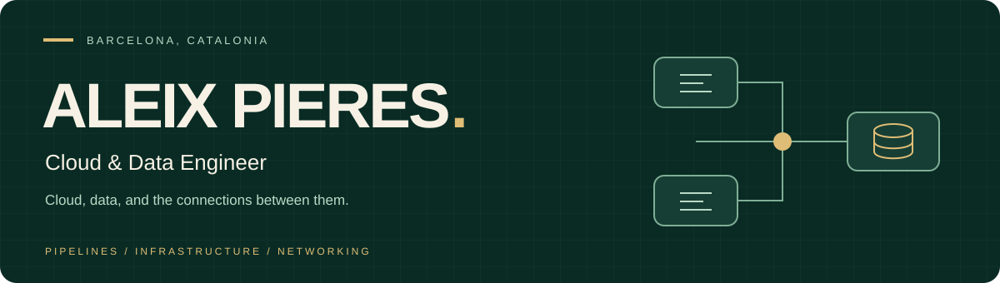



  

  
  
  

  <b>Data Engineer at MediaMarktSaturn</b> 
  Building dependable data pipelines, automating cloud infrastructure, 
  and understanding the networks that connect everything.

 

### Focus

<table>
  <tr>
    <td width="33%" valign="top"><h3>01 / Data</h3>
Pipelines, data quality, and scalable processing for analytics and business decisions.
</td>
    <td width="33%" valign="top"><h3>02 / Cloud</h3>
Infrastructure automation, autoscaling, and managed services that make platforms easier to operate.
</td>
    <td width="33%" valign="top"><h3>03 / Networks</h3>
Google Cloud connectivity, load balancing, and troubleshooting across VPCs, VPNs, and GKE.
</td>
  </tr>
</table>

### Selected builds

**[PyPhantom ↗](https://github.com/aleixpieres/PyPhantom)** 
A Discord integration prototype that uses Ollama for generated replies and summaries of recent conversations. 
`Python` `discord.py` `Ollama`

**[UDP file transfer ↗](https://github.com/aleixpieres/UDPserver)** 
A client-server protocol exercise exploring data blocks, acknowledgements, and timeout handling. 
`Python` `Sockets` `Networking`

[Browse all repositories →](https://github.com/aleixpieres?tab=repositories)

### Toolkit

| Cloud & infrastructure | Data & analytics | Software & integrations |
| :--- | :--- | :--- |
| Google Cloud · Terraform | Python · SQL · Snowflake | Django · JavaScript |
| Docker · GKE · Nginx | PostgreSQL · MySQL · MongoDB | HTML/CSS · C/C++ · Ollama |
| Git · VPC · VPN | Data pipelines · Data quality | Service integrations |

 

---

  <b>Cloud infrastructure. Better data. Technical collaboration.</b> 
  <a href="mailto:aleixpierescarrasco@gmail.com">Let's connect →</a>

